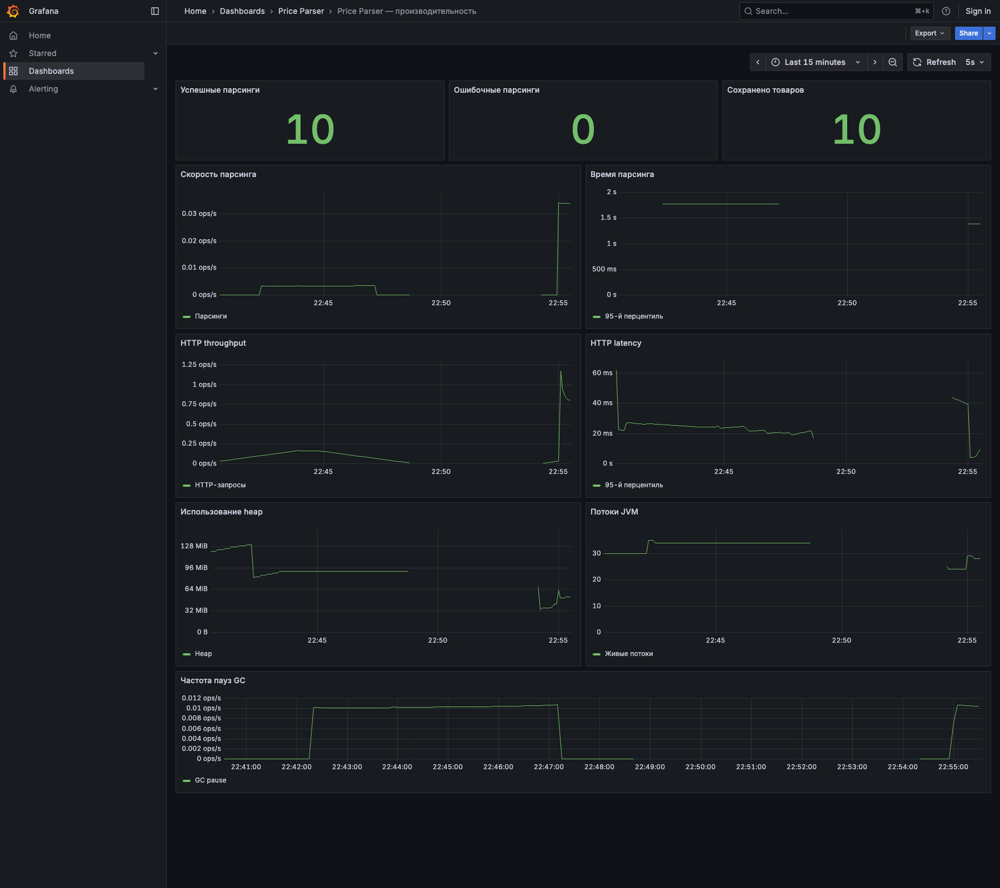
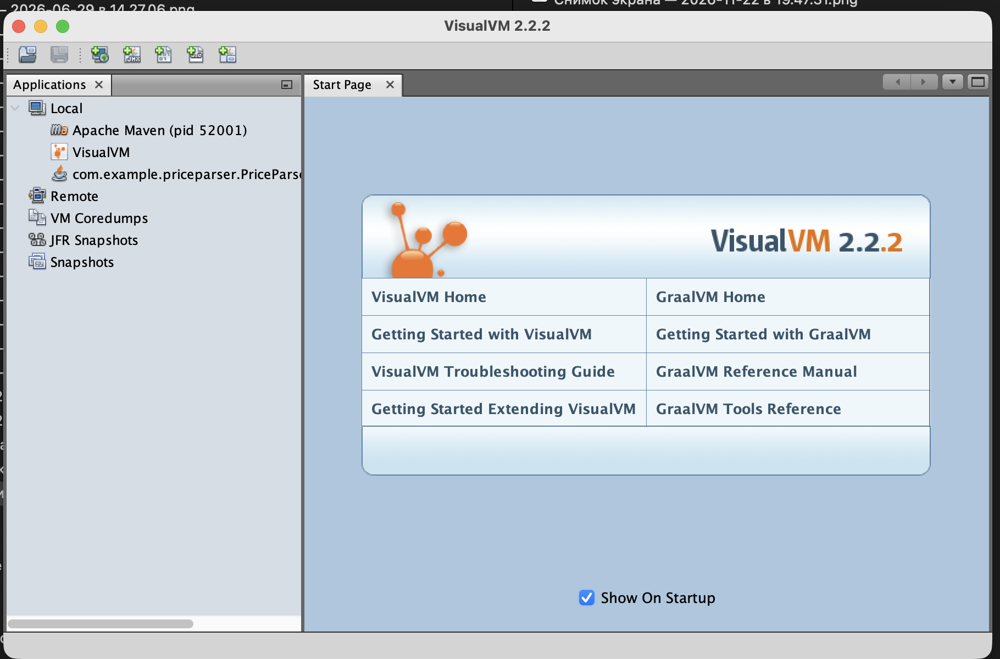
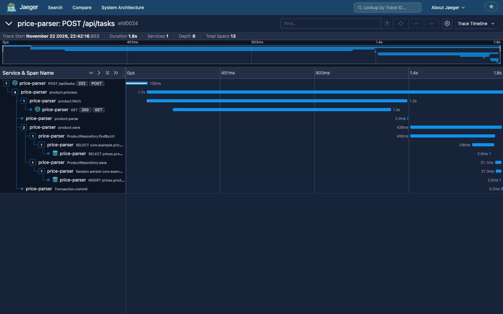

# Управление производительностью price-parser

## 1. Предмет анализа

Проект реализует вариант 2 «Парсер цен на товары». Приложение на Java 21 и Spring Boot 4.1.1 загружает страницы books.toscrape.com, разбирает HTML через Jsoup и сохраняет товары в H2. Обработка выполняется асинхронно через producer-consumer с `LinkedBlockingQueue`, отдельным потоком-производителем и фиксированным пулом из четырёх потребителей.

Цель работы: измерить производительность, добавить мониторинг и трассировку, исследовать JVM и проверить оптимизации повторными замерами.

## 2. Настройка Actuator, Micrometer и Prometheus

В `pom.xml` добавлены `spring-boot-starter-actuator` и `micrometer-registry-prometheus`. Через `application.properties` открыты `health`, `info`, `metrics`, `threaddump` и `prometheus`.

Actuator предоставляет:

- `/actuator/health`: состояние приложения и H2;
- `/actuator/info`: название, описание и версия приложения;
- `/actuator/metrics/http.server.requests`: количество и длительность HTTP-запросов;
- `/actuator/threaddump`: потоки JVM и их состояния;
- `/actuator/prometheus`: метрики в формате Prometheus.

Пользовательские метрики в `ProductProcessor`:

| Метрика | Назначение |
|---------|------------|
| `parser.parsing.duration` | Полное время загрузки, разбора и сохранения товара |
| `parser.parsing.successful` | Количество успешных обработок |
| `parser.parsing.failed` | Количество ошибочных обработок |
| `parser.products.saved` | Количество сохранений записей в H2 |

Для длительности используется `Timer.Sample`, запущенный через `Timer.start(meterRegistry)`. Счётчики реализованы через Micrometer `Counter`. Гистограммы включены для `parser.parsing.duration` и `http.server.requests`.

## 3. Prometheus и Grafana

`compose.yaml` поднимает Prometheus 3.5.0 и Grafana 12.1.1. Prometheus каждые пять секунд обращается к `host.docker.internal:8080/actuator/prometheus`. Grafana автоматически получает datasource `http://prometheus:9090` и дашборд `Price Parser: производительность`.

Дашборд содержит десять панелей: счётчики парсинга и сохранений, скорость и 95-й перцентиль обработки, HTTP throughput/latency, heap, потоки JVM и паузы GC. PromQL всех панелей проверен через datasource Grafana.

Итоговый снимок после JMeter:



На момент снимка: 10 успешных парсингов, 0 ошибок и 10 сохранений товаров.

## 4. JMH

`ProductQueryBenchmark` сравнивает одинаковые фильтрацию, сортировку и преобразование результата через `for`, `stream()` и `parallelStream()`. Используются JMH 1.37, режим среднего времени, три итерации прогрева и пять итераций измерения в отдельной forked JVM.

Первоначальные результаты, мс/операция:

| Товаров | `for` | `stream()` | `parallelStream()` |
|---:|---:|---:|---:|
| 1 000 | 0,034 ± 0,001 | 0,034 ± 0,002 | 0,090 ± 0,011 |
| 10 000 | 0,357 ± 0,078 | 0,330 ± 0,029 | 0,241 ± 0,041 |
| 100 000 | 4,915 ± 0,185 | 3,836 ± 0,035 | 1,560 ± 0,118 |

На 1 000 записей параллельный вариант медленнее. На 10 000 и 100 000 записей его среднее время ниже.

После выявления повторного `toLowerCase` добавлен вариант `parallelStreamPrecomputedTitle`. Сравнение в одном запуске JMH:

| Товаров | До | После |
|---:|---:|---:|
| 1 000 | 0,087 ± 0,001 | 0,086 ± 0,003 |
| 10 000 | 0,222 ± 0,002 | 0,212 ± 0,002 |
| 100 000 | 1,521 ± 0,019 | 1,506 ± 0,016 |

На 10 000 записей среднее время снизилось примерно на 4,5%. На 100 000 разница около 1%, доверительные интервалы пересекаются, поэтому ускорение на этом размере не подтверждено.

## 5. JMeter

Тест-план `jmeter/price-parser-baseline.jmx` создаёт 20 пользователей для 500 GET-запросов `/answer` и пять пользователей для 10 POST-запросов `/api/tasks`. Тест запускается в CLI-режиме, результат сохраняется в CSV и HTML.

Базовый замер:

| Запрос | Количество | Throughput, запросов/с | Среднее, мс | p95, мс | Ошибки |
|--------|---:|---:|---:|---:|---:|
| `GET /answer` | 500 | 105,49 | 2,126 | 4 | 0% |
| `POST /api/tasks` | 10 | 6,39 | 9,9 | 71 | 0% |

Финальный замер после изменений:

| Запрос | Количество | Throughput, запросов/с | Среднее, мс | p95, мс | Ошибки |
|--------|---:|---:|---:|---:|---:|
| `GET /answer` | 500 | 104,71 | 2,910 | 5 | 0% |
| `POST /api/tasks` | 10 | 6,39 | 9,2 | 69 | 0% |

HTTP-ускорение не обнаружено. В тесте в H2 находится один товар, поэтому оптимизация фильтрации не влияет заметно на HTTP latency. `POST /api/tasks` возвращает `202 Accepted` после постановки задачи; полное время обработки измеряется отдельно через Micrometer и OpenTelemetry.

Финальный запуск также дал 10 успешных фоновых парсингов и 0 ошибок сохранения.

## 6. VisualVM, память и GC

Использовались VisualVM 2.2.2, GC-лог JVM, JFR и `jcmd`. Приложение запускалось с:

```bash
-Xlog:gc*:file=build/visualvm/gc.log:time,uptime,level,tags
```

Во время трёх JMeter-запусков выполнено 1 530 HTTP-запросов без ошибок. Сняты thread dump, heap dump, JFR-запись и class histogram.

Результаты:

- JFR зафиксировал 19 пауз GC: средняя 4,22 мс, p95 и максимум 13,5 мс.
- Выраженного CPU hotspot не обнаружено. У `StringLatin1.inflate` больше всего samples, но только 7,41%.
- События contention отсутствуют.
- Deadlock в thread dump не обнаружен.
- Во время нагрузки четыре `parser-worker` были `RUNNABLE`; потоки-производители ожидали `CountDownLatch`.
- До heap dump было занято 64,4 МБ heap.
- Больше всего памяти занимали byte arrays: 11,1 МБ, `Class`: 2,53 МБ, `String`: 2,37 МБ.
- Full GC при диагностике вызывался командами heap inspection и heap dump, а не обычной нагрузкой.



## 7. Найденные проблемы и изменения

### Повторные аллокации и вычисления

`ProductQueryService` вызывал `filter.title().toLowerCase(Locale.ROOT)` для каждого товара. Теперь условие нормализуется один раз на запрос. Поведение для `null` и пустой строки сохранено, существующие тесты фильтрации проходят.

### Транзакции и синхронизация

`ProductStorage.save` выполняет чтение и обновление в одной `@Transactional`, а `findAllUrls` использует `@Transactional(readOnly = true)`.

Повторный JMeter выявил гонку после добавления транзакции: `ReentrantLock` в `ProductStorage` освобождался до commit. Параллельная вставка одинакового URL могла завершиться ошибкой уникального индекса. Блокировка перенесена в `ProductProcessor`, поэтому она охватывает вызов транзакционного метода и commit.

Добавлен `ProductProcessorTest`: десять потоков одновременно обрабатывают один URL, после чего в H2 остаётся одна запись. Все 14 тестов проходят.

### Запросы и индексы

N+1-запросы не обнаружены: у `Product` нет связей с другими сущностями. Уникальное ограничение `URL` уже создаёт индекс. Дополнительные индексы не добавлялись, поскольку фильтрация `/answer` выполняется в памяти и не использует их.

## 8. OpenTelemetry и Jaeger

В Compose добавлен Jaeger 2.23.0. Приложение запускается с OpenTelemetry Java Agent 2.34.0 и OTLP HTTP exporter на `localhost:4318`.

Пользовательские spans:

- `product.process`;
- `product.fetch`;
- `product.parse`;
- `product.save`.

`CrawlService` передаёт контекст в потребители и поток-производитель через `Context.wrap()`. Это связывает фоновую работу с исходным HTTP-запросом. Java Agent также создаёт spans для внешнего HTTP, Spring Data, JDBC и commit.

Проверенная трассировка содержит 13 spans и глубину 6. В неё входят `POST /api/tasks`, все пользовательские этапы, внешний GET, вызовы репозитория, SQL SELECT/INSERT и `Transaction.commit`.



Длительность трассировки: 1,8 секунды. Лог этапов показал: загрузка 1 247 мс, разбор 2 мс, сохранение 453 мс. Основное время занимает внешний HTTP и сохранение, разбор HTML занимает малую долю.

## 9. Алгоритмическая сложность

Обозначения: `N`: число товаров в БД, `M`: число товаров после фильтрации, `L`: число найденных ссылок, `H`: размер HTML.

| Участок | Сложность | Память |
|---------|-----------|--------|
| Добавление/поиск задачи в `ConcurrentHashMap` | В среднем O(1) | O(1) на операцию |
| Дедупликация ссылок через `HashSet` | В среднем O(1) на ссылку, O(L) на задачу | O(L) |
| `LinkedBlockingQueue.put/take` | O(1) | Очередь ограничена настройкой |
| Разбор HTML Jsoup | O(H) | O(H) для DOM |
| Поиск товара по уникальному URL в H2 | O(log N) для индекса | O(1) на запрос |
| Фильтрация `/answer` | O(N) | O(N) для `findAll`, O(M) для результата |
| Сортировка отфильтрованных товаров | O(M log M) | O(M) |
| Пагинация через `subList` | O(1), создаётся представление списка | O(1) |
| Общая обработка `/answer` | O(N + M log M) | O(N + M) |

`parallelStream()` не меняет алгоритмическую сложность. Он распределяет работу между потоками, добавляя накладные расходы на разбиение и объединение. JMH подтвердил проигрыш на малом наборе и выигрыш на больших наборах.

## 10. Bounded contexts и границы архитектуры

Приложение остаётся модульным монолитом, но границы соответствуют выделению bounded contexts:

| Контекст | Пакеты | Ответственность |
|----------|--------|-----------------|
| Управление сбором | `crawl` | Жизненный цикл задач, очередь, producer-consumer, счётчики |
| Получение и интерпретация страниц | `client`, `parser` | HTTP, повторы, таймауты, преобразование HTML в `ParsedProduct` |
| Каталог товаров | `product` | Сущность, транзакции, сохранение, фильтрация и пагинация |
| Обновление цен | `scheduler` | Периодический запуск обновления сохранённых товаров |
| HTTP-адаптеры | `web` | REST API и преобразование запросов/ответов |
| Инфраструктура | `config`, `logging` | Пулы потоков, настройки и файловый журнал |

`ProductRepository` принадлежит контексту каталога. Другие контексты не создают таблицы и не изменяют записи напрямую. При выделении отдельных микросервисов границы уже определены: сбор задач, обработка страниц и каталог можно разворачивать и масштабировать независимо, используя API или очередь вместо локальных вызовов.

## 11. Ограничения измерений

- Тесты выполнены на одной локальной JVM с H2 in-memory.
- Нагрузка `/answer` использует один сохранённый товар, поэтому не заменяет тест с большим набором данных.
- JMH измеряет обработку в памяти без H2 и HTTP.
- Внешний сайт влияет на длительность парсинга и доступность.
- Результаты относятся к JDK 21.0.8 и указанным версиям инструментов; для другого окружения нужны повторные замеры.

## 12. Материалы

- Исходный код и конфигурация: корень репозитория.
- JMeter test plan: `jmeter/price-parser-baseline.jmx`.
- JMH benchmark: `src/test/java/com/example/priceparser/product/ProductQueryBenchmark.java`.
- Регрессионный тест: `src/test/java/com/example/priceparser/product/ProductProcessorTest.java`.
- Дашборд: `monitoring/grafana/dashboards/price-parser-performance.json`.
- Презентация: `docs/performance-presentation.pptx` и `docs/performance-presentation.pdf`.
- Полные команды: `README.md`.
